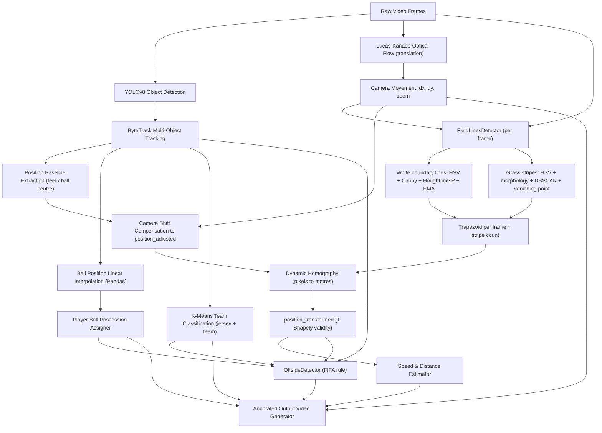

# AI-Powered Football Match Analysis — Tracking System & Offside Detection
[](https://www.python.org/)
[](https://github.com/ultralytics/ultralytics)
[](https://opencv.org/)
[](https://pytorch.org/)
[](LICENSE)

## Overview

I built this project to **detect and track players, referees, and the ball** in match footage using **YOLO**, and to train the model for better performance. 

Using **K-Means clustering on jersey colours**, I automatically assign players to teams and measure each team's **ball-possession percentage**. I estimate **camera movement with optical flow**, apply a **perspective transformation** to convert pixel positions into **real-world metres**, and compute each player's **speed and distance covered**. 

The result is a complete, hands-on pipeline covering detection, tracking, team classification, and physical metrics — suitable for both beginners and experienced ML engineers.

Built on top of [Abhishek Sakapal's football-analysis](https://github.com/abdullahtarek/football_analysis.git) pipeline, this fork adds **dynamic field area detection**, **camera zoom compensation**, and a **real-time offside detector**.


## My Contributions

### 1. Dynamic Field Area Detection
- Detects the visible field area **per frame** (not a static trapezoid) by intersecting white boundary lines with grass mowing patterns
- Adapts to camera pan, tilt, and zoom in real time
- Uses EMA-stabilized line tracking, DBSCAN clustering of grass stripes, and an anchor-based ROI to filter out advertising boards

### 2. Camera Zoom Compensation
- Measures zoom factor via optical flow on a 3×3 grid of features (original pipeline only estimated translation)
- Output format extended from `[Δx, Δy]` to `[Δx, Δy, zoom]`

### 3. Offside Detection
- Applies the FIFA offside rule per frame: penultimate defender + goalkeeper detection
- Automated attacking direction detection; handles missing goalkeeper (off-screen) gracefully
- Offside players get a red bounding box + "OFFSIDE" label in the output video

> Full technical details: [docs/TECHNICAL.md](docs/TECHNICAL.md)

## Base Pipeline

| Step | Module | Technology |
|------|--------|------------|
| 1 | Object Detection & Tracking | YOLOv8 + ByteTrack |
| 2 | Camera Movement | Lucas-Kanade Optical Flow |
| 3 | View Transformation | Perspective warp (pixels → metres) |
| 4 | Ball Interpolation | Pandas linear interpolation |
| 5 | Speed & Distance | Euclidean distance over frame windows |
| 6 | Team Assignment | K-Means jersey colour clustering |
| 7 | Ball Possession | Nearest-player distance threshold |

## Modules Used

- YOLO: AI object detection model
- K-Means: Pixel segmentation and clustering for jersey colour
- Optical Flow: Camera movement and zoom estimation
- Perspective Transformation: Scene depth and real-world coordinates
- Offside Detection: FIFA rule-based positional analysis

## Mathematics & CV Pipeline Architecture



## Trained Models

- [Trained YOLO model](https://drive.google.com/file/d/1DC2kCygbBWUKheQ_9cFziCsYVSRw6axK/view?usp=sharing) → place in `models/best.pt`

## Sample Video

- [Sample input video](https://drive.google.com/file/d/1t6agoqggZKx6thamUuPAIdN_1zR9v9S_/view?usp=sharing) → place in `input_videos/match.mp4`

## Output Video

- [Current output video](https://drive.google.com/file/d/1mKb3jt0DKx-GBEeaTfd9c2OQ521DzOVa/view?usp=sharing) → place in `output_videos/output_video.mp4`

## Requirements

- Python 3.x
- ultralytics
- supervision
- opencv-python
- numpy
- matplotlib
- pandas
- shapely
- scikit-learn

```bash
pip install -r requirements.txt
```

## Usage

### Run locally

```bash
python main.py          # full pipeline → output_videos/output_video.avi
python yolo_inference.py # raw YOLO inference only
```

First run caches results to `stubs/`; subsequent runs load from cache. Set `read_from_stub=False` in `main.py` to force recomputation.

### Run on Google Colab

[](https://colab.research.google.com/github/PedoneMatteo/football-offside-analysis/blob/main/run_pipeline_football_analysis.ipynb)

No setup required — the notebook `run_pipeline_football_analysis.ipynb` clones the repo, installs dependencies, downloads the model and sample video, runs the pipeline, and lets you download the annotated output.

## Credits

- **Original project**: [@abhisheksakapal](https://github.com/abdullahtarek/football_analysis.git)
- **Dynamic field detection, zoom compensation & offside module**: implemented on top of the original pipeline
- **YOLOv8**: Ultralytics | **ByteTrack**: supervision

## License

Inherits the license of the original [football-analysis](https://github.com/abdullahtarek/football_analysis.git) repository.
